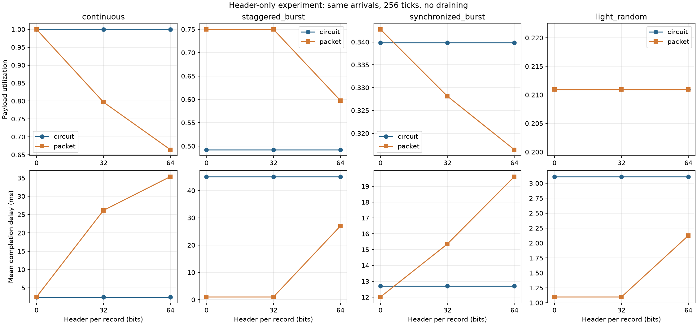

# 实验一：电路交换与分组交换的资源利用率比较

姓名：郑航宇　学号：2024280087　GitHub：erjimeidianle  
日期：2026-10-19　起始版本：bc9099e  
提交授权：本人于2026-10-19回复“审阅完毕直接提交吧”。本版本据此进入提交流程，实际提交SHA与PR网址以Git记录和教师仓库PR为准。

## 实验目的

在相同业务输入、链路容量、缓存和观察窗口下，比较固定时隙预留与共享 FIFO 的资源使用、完成时延、丢失和积压。通过先验手算、分项测试、真实仿真和参数变化判断结论的适用条件。

本报告由 Codex 辅助实现、推演、运行和整理。下述结果来自实际执行；本人已表示审阅完毕并授权提交，此记录不等同于独立推导或未使用AI的声明。真实协作过程见 [AI_LOG.md](AI_LOG.md)，分阶段命令与日志见 [执行记录](docs/execution_log.md)。

## 原理和模型

基线完整配置：`users=4, ticks=256, slot_bits=128, tick_ms=1.0, header_bits=32, buffer_payload_bits=4096`，随机种子2026。窗口为[0,256)，总容量32768 bit，抽象链路速率128 kbit/s。

电路在 tick t 仅服务编号 `t % users` 的用户，队列为空就闲置，不借用配额；同一用户队列内 FIFO。分组使用共享 FIFO，包头只在准入时初始化一次，发送函数只扣 `remaining_wire_bits`。发完一条后可用剩余预算处理下一条，未发完的队首跨 tick 保留，不交错发送。

每 tick 先按原始输入顺序准入，再发送，完成时间统一取 tick+1 边界。两模型均按未完成记录的**完整原始 payload**预留总缓存，包括在传记录；完整交付才释放。空间不足时整条尾丢弃，包头占线路容量而不占本实验的 payload 配额。窗口结束立即停止，不追加排空。

PCM 图是教师提供的辅助装帧工具由本次程序生成的演示，32时隙×8 bit×8000帧/s＝2.048 Mbit/s，不是本次128 kbit/s比较链路。TS0、TS16保留，255仅是示例空闲码。

### 六项指标与单位

记生成、完整交付、尾丢弃、积压分别为 G、D、L、B（bit），实际发送线路量为 W（bit），总容量 C=ticks×slot_bits。

| 返回键 | 定义和单位 |
|---|---|
| payload_utilization | D/C，无量纲；表中以百分比表示 |
| wire_utilization | W/C，无量纲，含包头与未完成记录已发部分 |
| mean_delay_ms | 已完成记录的 delay_ticks×tick_ms 的算术平均，ms |
| max_delay_ms | 已完成记录的最大完成时延，ms |
| loss_ratio | L/G，无量纲；G=0时为0 |
| backlog_payload_bits | 全部未完成记录的原始payload总和，bit |

必须满足 G=D+L+B，不成立时 `summarize` 抛 `ValueError`。部分发送只增加 W，不增加 D，也不减少 B 中对应记录的原始 payload。没有完成记录时两个时延为 `None`（JSON null），因为没有样本，不能写成0 ms。

## 两用户手工推演

以下预期在修改三个 TODO 前写入执行记录：2用户、2 tick、每tick128 bit/1 ms、包头32 bit、缓存足够；仅tick0用户1到达96 bit。

| tick | 电路服务与发送 | 分组服务与发送 | 完成边界 |
|---|---|---|---|
| 0 | 用户0为空，发送0 bit | 发送96+32=128 bit，整条完成 | 分组1 ms |
| 1 | 用户1发送96 bit，整条完成 | 队列空，发送0 bit | 电路2 ms |

总容量256 bit，两者完整交付96 bit，有效利用率均96/256=37.5%。电路线路忙碌率37.5%，分组50%，完成时延分别2 ms与1 ms；两者均无丢失或积压。相同有效利用率并不意味着相同时延。

## 四场景真实结果

每个场景先生成同一份 Arrival 列表，再分别运行两模型；没有为任一模型改变负载、包头规则、种子、缓存或排空时间。continuous每4 tick所有用户各到达128 bit；staggered_burst每tick一条96 bit，热点每64 tick轮换；synchronized_burst每80 tick各用户集中到达8条96 bit；light_random每用户每tick以0.08概率到达96 bit。

原始证据：[JSON及轨迹](results/comparison.json)、[CSV](results/comparison.csv)。以下比率用百分比，时延四舍五入至4位小数；原始文件保留完整浮点值。

| 场景 | 模型 | 有效利用率% | 线路忙碌率% | 平均时延ms | 最大时延ms | 丢失率% | 积压bit |
|---|---|---:|---:|---:|---:|---:|---:|
| continuous | circuit | 100 | 100 | 2.5 | 4 | 0 | 0 |
| continuous | packet | 79.6875 | 100 | 26.1471 | 40 | 8.984375 | 3712 |
| staggered_burst | circuit | 49.21875 | 49.51171875 | 45.0952 | 127 | 18.359375 | 3936 |
| staggered_burst | packet | 75 | 100 | 1 | 1 | 0 | 0 |
| synchronized_burst | circuit | 33.984375 | 34.375 | 12.7069 | 24 | 0 | 1152 |
| synchronized_burst | packet | 32.8125 | 43.75 | 15.3571 | 32 | 0 | 1536 |
| light_random | circuit | 21.09375 | 21.09375 | 3.1111 | 10 | 0 | 0 |
| light_random | packet | 21.09375 | 28.125 | 1.0972 | 2 | 0 | 0 |

原始payload守恒复核（全部单位bit）：

| 场景 | 模型 | 生成 | 完整交付 | 尾丢弃 | 积压 |
|---|---|---:|---:|---:|---:|
| continuous | circuit | 32768 | 32768 | 0 | 0 |
| continuous | packet | 32768 | 26112 | 2944 | 3712 |
| staggered_burst | circuit | 24576 | 16128 | 4512 | 3936 |
| staggered_burst | packet | 24576 | 24576 | 0 | 0 |
| synchronized_burst | circuit | 12288 | 11136 | 0 | 1152 |
| synchronized_burst | packet | 12288 | 10752 | 0 | 1536 |
| light_random | circuit | 6912 | 6912 | 0 | 0 |
| light_random | packet | 6912 | 6912 | 0 | 0 |


连续满载且各用户供给均匀时，电路配额均被使用，没有分组头开销。分组线路虽也100%忙碌，却只完整交付26112 bit，且有2944 bit丢弃、3712 bit积压；忙碌不等于有效吞吐更高。

错峰热点场景下，电路空闲用户的时隙不能借给热点，积压接近缓存上限，尾丢弃4512 bit。共享FIFO能每tick完整发送一条96+32 bit记录，零丢失、零积压，平均完成时延1 ms；该条件下统计复用有明显优势。

同步突发时两者均排队，分组头增加线路工作量。窗口末尾最后一批未全部送达，分组积压1536 bit，比电路1152 bit更多；完成样本的平均时延不能代表尚未完成的记录。积压保留在缓存中，不能当成已经丢弃的数据。

轻载下两者都交付6912 bit，有效利用率完全相同，但分组平均时延约1.0972 ms，小于电路3.1111 ms；分组也因包头多使用线路容量。它与两用户手算一起说明，要明确比较的是有效吞吐、资源开销还是时延。


队列图记录每tick服务后的原始payload预留量。电路曲线接近4096 bit配额；分组在该场景每tick恰好完成一条，因此服务后为0，不表示tick开始从未有记录进入缓存。


## 自拟反例：在传缓存的释放时刻

详见 [test_my_case.py](student_tests/test_my_case.py)。本案例由AI在本次任务中提出并编写，经过实际运行；不声称是本人在未使用AI情况下独立创作。

packet配置：users=2、ticks=3、slot_bits=128、tick_ms=1、header_bits=32、buffer_payload_bits=200。到达为(0,1,200)、(1,0,64)、(2,0,200)，三元组依次代表tick、user、payload bit。

先验推导：tick0发送128，第一条还剩104 wire bit，但仍占200 payload bit；tick1先到达64，因200+64超额被整条丢弃，然后发送104、完成旧记录并释放缓存；tick2新200准入，发送128，窗口结束留200 bit积压。

关键断言：发送轨迹[128,104,128]，缓存轨迹[200,0,200]，唯一完成记录为user1/payload200/delay2；464=200+64+200。有效利用率200/384、线路忙碌率360/384、丢失率64/464，平均与最大时延2 ms。实际pytest为1 passed。

这能发现部分发送后提前缩减缓存占用、先发送后准入、部分发送误记完整交付、窗口结束继续排空等错误。断言同时检查轨迹与最终指标，不能仅靠守恒掩盖错误的准入顺序。

## 包头参数变化实验

通过既有Config入口分别设置header_bits=0、32、64；其他五个Config字段保持基线，seed=2026，每场景Arrival与基线完全相同。0 bit是抽象的无头开销对照，不表示真实网络可取消协议头。脚本：[header_experiment.py](scripts/header_experiment.py)。

产物独立保存：[完整参数和24组轨迹](results/extra/header_sweep.json)、[24行CSV](results/extra/header_sweep.csv)。下表仅列分组指标，电路全部raw在三种配置中完全一致。

| 场景 | 包头bit | 有效利用率% | 平均时延ms | 丢失率% | 积压bit |
|---|---:|---:|---:|---:|---:|
| continuous | 0 | 100 | 2.5 | 0 | 0 |
| continuous | 32 | 79.6875 | 26.1471 | 8.984375 | 3712 |
| continuous | 64 | 66.40625 | 35.3706 | 21.875 | 3840 |
| staggered_burst | 0 | 75 | 1 | 0 | 0 |
| staggered_burst | 32 | 75 | 1 | 0 | 0 |
| staggered_burst | 64 | 59.765625 | 27 | 3.90625 | 4032 |
| synchronized_burst | 0 | 34.27734375 | 12.0085 | 0 | 1056 |
| synchronized_burst | 32 | 32.8125 | 15.3571 | 0 | 1536 |
| synchronized_burst | 64 | 31.640625 | 19.6111 | 0 | 1920 |
| light_random | 0 | 21.09375 | 1.0972 | 0 | 0 |
| light_random | 32 | 21.09375 | 1.0972 | 0 | 0 |
| light_random | 64 | 21.09375 | 2.125 | 0 | 0 |



连续满载时头部占用更多容量，有效交付下降、队列时延增加。错峰业务由96 bit payload构成，32 bit头恰好使每记录占满一个tick；改64 bit头后每记录需160 bit，超过每tick128 bit供给能力，出现排队、丢失和积压。轻载全部payload仍能完成，0与32 bit的完成边界在本次样本中相同，64 bit需要更多tick，时延升高；不能推断指标会随包头大小在所有场景严格线性变化。

header32的所有rows和traces与默认基线完全一致，附加实验前后5个基线文件SHA256未变。这里只改变一个参数，固定种子的一个有限窗口无法代替多种负载和种子的统计置信分析。

## 验证与可复现方法

实际环境为Windows、Python3.14.5、NumPy2.5.4、Matplotlib3.11.2、pytest9.1.1，均满足教师依赖范围。实际版本冻结在 [requirements-lock.txt](requirements-lock.txt)。项目环境位于`.venv/`，缓存位于`.build/`，不升级共用工具环境。

在项目根目录运行：

```powershell
$env:PYTHONUTF8='1'
$env:PYTHONIOENCODING='utf-8'
$env:MPLCONFIGDIR=(Join-Path (Get-Location) '.build/matplotlib')
& .\.venv\Scripts\python.exe src/test_environment.py
& .\.venv\Scripts\python.exe -m pytest grading/test_framework.py -q
& .\.venv\Scripts\python.exe -m pytest grading/test_circuit.py -q
& .\.venv\Scripts\python.exe -m pytest grading/test_packet.py -q
& .\.venv\Scripts\python.exe -m pytest grading/test_metrics.py -q
& .\.venv\Scripts\python.exe src/performance_test.py
& .\.venv\Scripts\python.exe -m pytest grading/test_integration.py -q
& .\.venv\Scripts\python.exe -c "from src.performance_test import run; run('.build/repro')"
& .\.venv\Scripts\python.exe scripts/verify_baseline.py --repeat .build/repro
& .\.venv\Scripts\python.exe -m pytest student_tests -q
& .\.venv\Scripts\python.exe scripts/header_experiment.py
& .\.venv\Scripts\python.exe grading/calculate_grade.py
```

阶段性真实结果：框架4通过、电路4通过、分组4通过、指标3通过、集成3通过、自拟1通过。基线重复执行的JSON、CSV与3张PNG逐字节一致；PNG已解码并逐一打开检查，JSON/CSV数值、轨迹预算与守恒全部一致。原始输出与SHA256记录在`results/logs/`。

最终提交前完整回归`-m pytest grading student_tests -q`为**24 passed in 0.37s**（另含教师作业跟踪测试）。项目`preflight.py`已实际通过，核对受保护文件、原接口、全部报告指标与基线哈希。检查清单见[提交前清单](docs/submission_checklist.md)。

实际运行教师本地评分脚本，退出码0，`grade_report.json`状态为`ok`：环境5/5、电路20/20、分组20/20、指标15/15、产物10/10，自动项合计**70/70**。脚本文本显示“70.0/100”，其中教师人工30分待评，非最终成绩。原始结果为根目录`grade_result.txt`、`grade_report.json`及`results/logs/07_grade.txt`。

## 分析与限制

统计复用的收益依赖各用户业务何时到达、是否同时拥塞，以及包头与payload的比例。本次连续满载电路表现更好，错峰热点分组表现更好；不能推出真实互联网或电话系统的总体优劣。

本模型只含预先建立的单链路承载，忽略建链、传播、误码、重传和多跳；FIFO未模拟优先级和真实设备存储分配。完成时延只统计成功记录，必须同时看交付、丢失和积压，有限窗口不提供无限长稳态性能保证。所有完成都落在tick结束边界，离散化可能隐藏一个tick内的差异。

## AI使用与核心循环解释

AI先解释规则、列出手算，再逐个实现三个TODO，每个对应测试通过才继续。发送循环每轮取`min(剩余预算, 队首剩余wire)`，从两者扣去同一发送量；预算为0时停止，队首剩余为0才出队。这样既不会超额发送，也不会把部分记录误报为完成。分组函数不读取包头去加量，因为框架初始化时已计入一次；电路函数只选择当前用户队列，循环内不转去其他用户。

自拟反例和数据核验用于验证AI建议，真实探测错误、命令与采纳理由见AI_LOG。本人已表示审阅完毕并授权提交；个人独立推导、课堂反思及掌握程度没有由AI代为声明。

## 参考资料

以下资料均在本次实际阅读，属于仓库教学资料与源码；没有引入未经阅读的论文或外部实验结果。

1. [实验一PRD V1.2](codex_tasks/实验一_PRD_电路交换与分组交换.md)，2026-10-18，模型、验收、评分及操作要求。
2. [README](README.md)、[模型合同](docs/model_contract.md)、[电路原理](docs/theory_circuit.md)、[分组原理](docs/theory_packet.md)，本地起始版本bc9099e。
3. [数据类型](src/models.py)、[业务和仿真框架](src/utils.py)、[运行入口](src/performance_test.py)、[绘图程序](src/visualization.py)及公开grading测试与评分源码，本地起始版本bc9099e。
